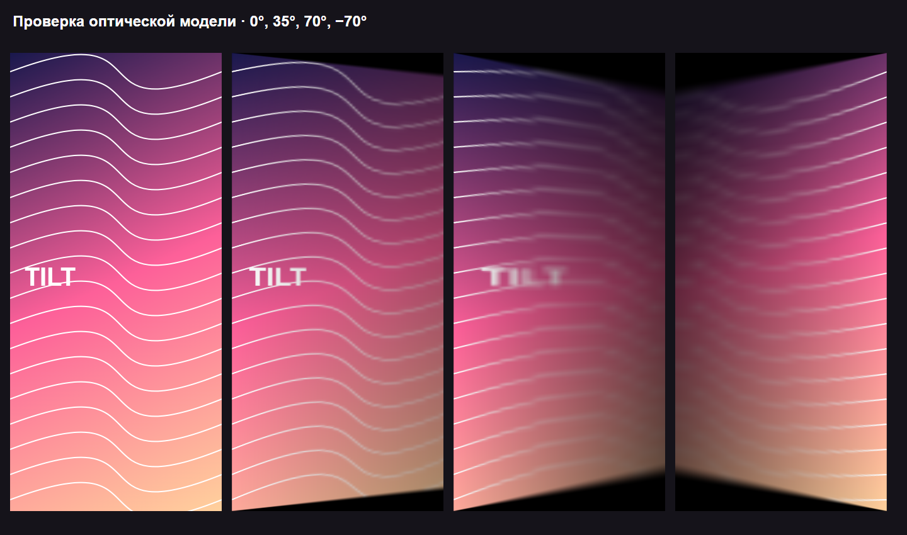

> **Tilt теперь называется Parallaxia.** Версия 2.0 готовится к выпуску: 33 эффекта, видеообои, отдельные обои для блокировки, пресеты и расписание. Стабильный релиз ниже — 1.1 (ещё под старым названием); обновление на 2.0 встанет поверх него.

<div align="center">
  
  <h1>Parallaxia</h1>
  <p>Живые обои с параллаксом. Твоя картинка — новая перспектива.</p>
  <p>Android live wallpaper · by <a href="https://github.com/kamradik">Kamradik</a></p>
  <p>
    <a href="https://github.com/kamradik/tilt-wallpaper/releases/latest"></a>
    
  </p>
</div>

**Parallaxia** (раньше — Tilt) превращает любое фото в живые обои: при наклоне телефона меняются перспектива, резкость и освещение. Эффект создаёт ощущение изображения за наклоняющимся стеклом.

**[Скачать Tilt-Personal-1.1.apk](https://github.com/kamradik/tilt-wallpaper/releases/download/v1.1/Tilt-Personal-1.1.apk)** · [Все релизы](https://github.com/kamradik/tilt-wallpaper/releases) · [Сообщить об ошибке](https://github.com/kamradik/tilt-wallpaper/issues)

## Возможности

- **Хаб эффектов:** 33 эффекта в шести категориях — оптика, свет и блики, вода и стекло, объём, атмосфера, ретро. Поиск, фильтры, избранное, недавние; превью каждого эффекта рендерится на твоём фото.
- **Главный экран и блокировка:** у экрана блокировки может быть своя картинка, свой эффект и свои параметры. Одни живые обои сами переключаются при разблокировке плавным переходом.
- **Параметры эффекта:** два ползунка и переключатель у каждого эффекта, кадрирование, сброс, импорт своей карты глубины для объёмных эффектов.
- **Настройки:** чувствительность, плавность, нейтральное положение, «Меньше движения», касания, вибрация, частота кадров (Авто/30/60), качество рендера, язык.
- **Spatial Scene:** карту глубины для объёмных эффектов считает нейросеть Depth Anything V2 Small прямо на телефоне, края подгоняются под фото.
- **Второй слой и готовые образы:** снег, капли, плёнка, свет или время суток поверх любого эффекта; десять готовых сочетаний, которые сохраняют твоё фото.
- **Виджет и иконки:** виджет на рабочий стол (следующий эффект, пауза) и четыре варианта иконки.
- **Физика на гироскопе:** снежный шар (тряска поднимает снег), песок, капли на стекле. **События:** пробуждение при разблокировке, свечение при зарядке, тон по времени суток.
- **Видеообои:** обрезка точно по кадру, звук удаляется, ролик перекодируется под размер обоев с частыми ключевыми кадрами — бесшовная петля и плавная «Перемотка наклоном» даже для 4K.
- **Пресеты и расписание:** сохранение и обмен файлами `.parallaxia` (старые `.tilt` тоже открываются), смена обоев по времени, «фото дня» из альбома, подборки и случайный эффект.
- **Система:** плитка «Пауза» в шторке, ярлыки на иконке, пауза при низком заряде, экран диагностики и журнал сбоев.
- Своя картинка из системного выбора фото или один из трёх процедурных фонов.
- Настоящие живые обои через Android WallpaperService; один движок для предпросмотра и рабочего стола.
- Без интернета, без аккаунта и без доступа ко всем файлам. Датчики и отрисовка останавливаются, когда обои не видны.
- Интерфейс в стиле iOS: стеклянная панель, крупные заголовки, пружинные анимации, переключатели и слайдеры как в iOS, тактильный отклик.
- Страница автора в виде карточки контакта: размытый фон из аватарки, GitHub и мини-плеер с тихой музыкой.

## Установка

1. Скачай APK из [Releases](https://github.com/kamradik/tilt-wallpaper/releases/latest) на телефон.
2. Открой APK и, если Android попросит, разреши установку для приложения, из которого открыл файл.
3. Запусти **Parallaxia** → **Выбрать фото** (или выбери образец в ряду «Фон»).
4. Нажми **Установить обои** и подтверди выбор в системном окне.
5. Наклоняй телефон. Положение экраном вверх даёт чёткую картинку; наклон меняет перспективу и размытие.

Доступность установки на рабочий стол и экран блокировки зависит от прошивки. В приложении есть переключатель **Ручной наклон** — он работает только в предпросмотре. Касание свободной области экрана скрывает панель, чтобы посмотреть обои целиком.

**Обновление с 1.0:** установи APK 1.1 поверх предыдущего. Имя пакета и сертификат подписи сохранены; удалять приложение не нужно.

## Страница автора

Нажми круглую аватарку справа от названия Parallaxia. Страница открывается переходом как в iOS: фон — размытая и медленно плывущая аватарка, сверху парит портрет, при прокрутке имя переезжает в навигационную панель. Музыка показана мини-плеером: обложка, индикатор воспроизведения, прогресс и время.

Музыка встроена в APK, играет по кругу на 12% от системной громкости. Кнопка паузы запоминает выключенный звук. При выходе со страницы, сворачивании или переходе в браузер воспроизведение освобождается; при возврате в ту же Activity продолжается с сохранённой позиции. Обои музыку не воспроизводят.

Автор: **[Kamradik](https://github.com/kamradik)**.

## Требования и проверка

| Параметр | Значение |
|---|---|
| Android | 11 и выше, minSdk 30 |
| Графика | OpenGL ES 3.0 |
| Датчики | Game rotation vector → rotation vector → gravity → акселерометр |
| Пакет | `dev.solotilt.personal` |
| Версия | 2.2-beta1 / versionCode 9 |
| Target / Compile SDK | 36 |
| Разрешения | Только `SET_WALLPAPER` |
| Интернет | Не требуется, разрешение INTERNET отсутствует |

На **Samsung S23 Ultra / One UI 8.5** пользователь подтвердил работу 1.0, iOS-интерфейса 1.1 и движка 2.0-beta2. Хаб эффектов, раздельные обои для блокировки и переключение при разблокировке собраны и проверены тестами, Android Lint и WebGL-проверкой шейдеров, но на телефоне ещё не запускались. Поведение других моделей и прошивок не подтверждено.

Оптическая модель Classic прошла WebGL2 smoke test. Ниже — **визуализация теста шейдеров, не скриншот Android-интерфейса**. В тесте используются обычные mipmaps вместо Android Gaussian-проходов.



## Как работает эффект

Основа — модель неподвижного изображения за стеклом, которое наклоняется относительно наблюдателя. Depth map, нейросеть и сегментация фотографии не требуются.

1. Датчики дают направление гравитации с учётом ориентации дисплея.
2. Углы сглаживаются с постоянной времени 70 мс и масштабируются на 0,75.
3. GPU строит перспективную проекцию для фиксированного наблюдателя на расстоянии 320 мм.
4. Размытие выбирается из заранее подготовленных Gaussian mip-уровней; зазор определяет его силу и затемнение.
5. Когда движение затухает, новые кадры перестают планироваться. При скрытии поверхности отключаются датчики.

Ориентир рендера — около 30 FPS. Изображение приводится к sRGB и ограничивается длинной стороной 2048 px. Подробности, формулы и происхождение модели: **[технический разбор](REVERSE_ENGINEERING_RU.md)**.

## Сборка из исходников

Сборка — **Gradle**: wrapper 8.14.3, Android Gradle Plugin 8.13.0, JDK 17, compileSdk 36. Подходят и Android Studio, и командная строка:

```powershell
git clone https://github.com/kamradik/tilt-wallpaper.git
cd tilt-wallpaper
./gradlew testDebugUnitTest assembleDebug
```

Путь к Android SDK задаётся в `local.properties` (`sdk.dir=...`) или переменной `ANDROID_HOME`. Результат: `app/build/outputs/apk/debug/app-debug.apk`; релизная сборка — `./gradlew assembleRelease`.

Если существует `.tools/personal-debug.jks`, debug- и release-сборки подписываются им, чтобы обновлять уже установленную копию. Другой ключ задаётся свойствами `tilt.keystore`, `tilt.storePassword`, `tilt.keyAlias` и `tilt.keyPassword` в `~/.gradle/gradle.properties`. Ключ опубликованного APK в репозиторий **не входит**; сборка с другой подписью не встанет поверх установленного приложения.

Windows с кириллицей в пути: `gradle.properties` отключает проверку пути плагина Android, а `gradlew`/`gradlew.bat` переносят служебный сокет Java в `C:\Users\Public` — во временной папке с кириллицей или коротким именем `~` он не создаётся.

### Тесты

`./gradlew testDebugUnitTest` запускает JUnit-тесты из `app/src/test`. `FoldMathTest` проверяет геометрию и датчик: нейтральное положение, эталонную проекцию, симметрию, ориентацию дисплея, положение экраном вниз, неверные данные и диапазон углов. `CoreTest` проверяет настройки: повреждённый и будущий формат, границы значений, сохранение и сброс, потокобезопасную передачу данных датчика.

Браузерная проверка шейдеров требует Node.js, Playwright и Chrome на Windows:

```powershell
npm install --no-save playwright
$env:PLAYWRIGHT_MODULE = 'playwright'
node tests/fx-check.cjs
```

`fx-check.cjs` собирает каждый эффект так же, как приложение (`fx/common.glsl` + эффект + `fx/main.glsl`), компилирует его в WebGL2 и рисует кадр при наклоне. Это не заменяет проверку на телефоне: WallpaperService, переключение блокировки, касания лаунчера и производительность GPU проверяются только на устройстве.

## Структура проекта

```text
app/src/main/java/dev/solotilt/personal/
  MainActivity.java      Хаб: предпросмотр, панель эффекта, каталог с поиском
  SettingsActivity.java  Общие настройки
  AuthorActivity.java    Страница Kamradik и мини-плеер
  Ios.java               iOS-палитра, пружины, стекло, контролы, списки, алерт
  Effects.java           Каталог эффектов: названия, параметры, флаги, поиск
  WallpaperConfig.java   Настройки v3: общие + профили «главный»/«блокировка», миграция
  TiltWallpaper.java     Живые обои: какой экран показывать, отслеживание блокировки
  RenderLoop.java        Поток рендера, EGL, два слоя, переходы, анимация
  GlScene.java           OpenGL: программа на эффект, слои, размытие, маска стекла
  Thumbnails.java        Превью эффектов на фото во внеэкранном контексте
  FoldMath.java          Геометрия и преобразование датчиков
  Motion.java            Датчики и фильтрация
  ImageStore.java        Импорт и хранение фото по экранам, процедурные фоны
  DepthMapManager.java   Карта глубины: автооценка, кэш, импорт
app/src/main/assets/fx/  GLSL: общий заголовок и по файлу на эффект
app/src/main/res/        UI-ресурсы, аватарка и музыка
tests/fx-check.cjs       Браузерная проверка всех шейдеров
REVERSE_ENGINEERING_RU.md Технический разбор
THIRD_PARTY_NOTICES.md   Источники и сведения о сторонних материалах
```

## Источники и авторство

Приложение создано по результатам анализа Android-версии **[Solo Tilt](https://solotilt.com/)**. Это отдельная реализация оболочки с собственным пакетом, интерфейсом и локальным импортом фото. Проект не является официальной сборкой Solo Tilt и не связан с Mojang или Microsoft.

Оптическая модель восходит к **[DuoLikeAnimation](https://github.com/elijah-semyonov/DuoLikeAnimation)**, © 2026 Elijah Semyonov, MIT; соответствующий текст лицензии сохранён. Три шейдера взяты из исследованного APK Solo Tilt. Лицензия базовой модели не означает автоматически, что весь оригинальный APK и все его изменения распространяются под MIT.

Аватарка и музыкальный файл предоставлены Kamradik. Общая лицензия на все материалы репозитория не назначена; происхождение и границы известной лицензии перечислены в **[THIRD_PARTY_NOTICES.md](THIRD_PARTY_NOTICES.md)**.

Публичный репозиторий содержит исходники этой реализации и техническое описание. Оригинальный APK, сырая декомпиляция, инструменты исследования, локальные пути пользователя и приватные ключи подписи сюда не включены.
